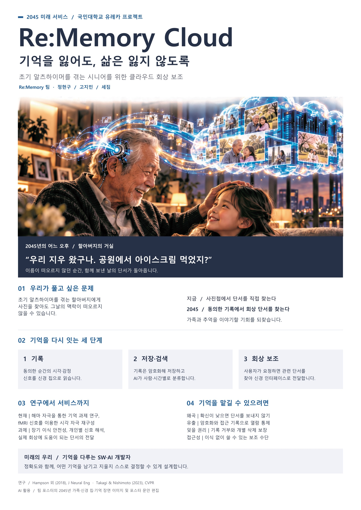

# Welcome to E26-SW01-15

## 🎯 팀 슬로건

> 끝없는 바다처럼, 무한한 가능성

## 🖼️ 팀 포스터

<div class="poster"></div>

<p align="center" class="poster-caption"><sub>이정문 화백, 「서기 2000년대 생활의 이모저모」(1965). 출처: <a href="https://v.daum.net/v/d4FeeJV0EN">전자신문 [과학 핫이슈] 1965년에 상상한 2000년대, 지금 그려보는 20년 후</a></sub></p>

1965년에 35년 뒤의 생활을 상상해 그린 이 그림처럼, 우리 팀이 그리는 미래를 포스터로 만들어 봅시다.
팀 활동으로 만든 포스터를 `poster.jpg` 파일 이름으로 이 repository에 업로드하면 위 그림이 팀 포스터로 바뀝니다.
파일 이름이 다르거나 png 파일이면 위 ``의 파일 이름을 맞추고, 출처 문구도 팀에 맞게 고쳐 주세요.

> **포스터 파일 권장 규격**: A4 세로 비율(1 : 1.414), 1240×1754px 이상, JPG, 2MB 이하.
> 홈페이지에서는 어떤 크기·비율의 파일을 올려도 같은 크기의 세로 틀 안에 맞춰 표시되지만, 권장 규격을 지키면 여백 없이 가장 선명하게 보입니다.

***

## 1️⃣ 팀원 소개

| **이름** | **전공** | **관심사** |
| --- | --- | --- |
| **정현구** | 소프트웨어전공 | AI, 로봇, 임베디드, 게임, 창업, 요리, 스노우보드, 그림, 헬스 |
| **세짐** | 소프트웨어전공 | 인공지능, 알고리즘, 사이버보안, 음악 감상, 독서 |
| **고지민** | 소프트웨어전공 | AI, 게임개발, 웹, 스케이트, 헬스, OTT 시청, 산책 |
|  |  |  |


유레카프로젝트 팀 생성을 축하합니다.
팀의 제목과 슬로건, 팀원의 이름 및 관심사를 변경하세요.

### 팀 소개

팀의 소개를 작성합니다.

***

## 2️⃣ 공통된 관심사 : 여행, 백엔드, 인공지능

***

## 3️⃣ 한학기 동안의 활동 내역 

- 기관/부서 인터뷰 ✔️  

- 현장 탐방 ✔️  

- 멘토링 ✔️  
  - 내 지도 교수 함게 만나기
  - 대학원 방문 및 선배 만나기

- 프로젝트 진행 ✔️  
  - 과거에 사람들이 상상한 미래
  - 그들이 만들어가는 세상
  - 우리가 상상한 미래
  - 우리가 그리는 미래 그리고 나

### 「서기 2000년대 생활의 이모저모」 감상

그림이 그려진 시대의 생활 모습을 이해하기 위해 검정고무신 애니메이션과 비교하면서 감상했다.

그 당시 상상했던 기술들이 지금은 대부분 구현되어 있다는 점이 신기했다. 하지만 지금의 모습을 예상하기 어려웠는지 TV는 옛날 TV와 비슷한 모습으로 그려져 있었다.

우주선을 타고 수학여행을 가는 것은 아직 어렵지만 기술이 계속 발전하면 언젠가는 가능할 것 같다. 태양에너지를 이용하는 집도 당시에는 관련 기술이 널리 사용되지 않았을 텐데 미리 상상했다는 점이 놀라웠다.

집에서 원격으로 진료받는 모습은 요즘 AI에게 증상을 말하고 관련 정보를 얻는 것과 비슷하다고 생각했다. 그림을 보면서 과거 사람들이 상상한 미래와 우리가 살고 있는 현재가 많이 닮아 있다는 것을 알 수 있었다.

### 유리 디스플레이

그림 속 유리 디스플레이를 보고 유리 뒤에 회로가 보이지 않는데 어떻게 화면을 출력할 수 있을지 토론했다. 홀로그램이나 빛의 반사를 이용할 수 있을 것 같지만 지금 기술로 완전히 구현하기는 어려워 보인다는 의견이 있었다. 비슷한 기술을 본 적이 있어서 언젠가는 가능할 것 같다는 의견도 있었다.

이런 디스플레이가 꼭 필요한지에 대해서도 이야기했다. 실생활에서 딱히 필요하지 않을 것 같다는 의견이 있었고 기능보다는 미적인 부분 때문에 사용할 수 있을 것 같다는 의견도 있었다. 화장실이나 건물에서 스위치를 누르면 투명한 유리가 불투명하게 바뀌는 기술이 이미 사용되고 있다. 유리의 상태를 바꾸는 기술이 더 발전하면 그림과 비슷한 디스플레이도 만들 수 있을 것 같다고 생각했다.

### 하늘을 나는 자동차

하늘을 나는 자동차는 오래전부터 곧 나온다는 이야기가 있었지만 아직 상용화되지 않았다. 기술적으로 만드는 것은 가능하더라도 법과 안전 문제가 해결되지 않았기 때문이라고 생각했다.

하늘을 나는 자동차를 항공법으로 다뤄야 할지 도로교통법으로 다뤄야 할지도 문제가 될 수 있다. 도로에서 자동차가 고장 나는 것보다 공중에서 고장 나는 것이 훨씬 위험하고 대처하기도 어렵다. 이런 문제들이 해결되어야 실제 생활에서 사용할 수 있을 것이라고 생각했다.

- 각오와 소감 나누기 ✔️  


<!-- 활동 사진 추가 예시 -->


***

## 4️⃣ 인상 깊은 활동

- 활동명 – 활동에 대한 간단한 설명과 배운 점을 작성  
- 예: 멘토링에서 실리콘밸리 현업 경험을 들을 수 있어 진로 방향 설정에 큰 도움이 되었다.  

***

## 5️⃣ 특별히 알아보고 싶은 것
- 예: 현장실습 제도
- 예: 학부 졸업 인증 조건
- 예: 성취기반평가
- 예: 졸업 후 진로(대학원/취업)

***

## 6️⃣ 활동을 마친 소감

🔗학번 이름  
> "소감 내용을 여기에 작성합니다."

🔗학번 이름  
> "소감 내용을 여기에 작성합니다."

🔗학번 이름  
> "소감 내용을 여기에 작성합니다."

🔗학번 이름  
> "소감 내용을 여기에 작성합니다."

🔗학번 이름  
> "소감 내용을 여기에 작성합니다."


## Markdown을 사용하여 내용꾸미기를 익히세요.

Markdown은 작문을 스타일링하기위한 가볍고 사용하기 쉬운 구문입니다. 여기에는 다음을위한 규칙이 포함됩니다.

```markdown
Syntax highlighted code block

# Header 1
## Header 2
### Header 3

- Bulleted
- List

1. Numbered
2. List

**Bold** and _Italic_ and `Code` text

[Link](url) and 
```

자세한 내용은 [GitHub Flavored Markdown](https://guides.github.com/features/mastering-markdown/).

### Support or Contact

readme 파일 생성에 추가적인 도움이 필요하면 [도움말](https://help.github.com/articles/about-readmes/) 이나 [contact support](https://github.com/contact) 을 이용하세요.

